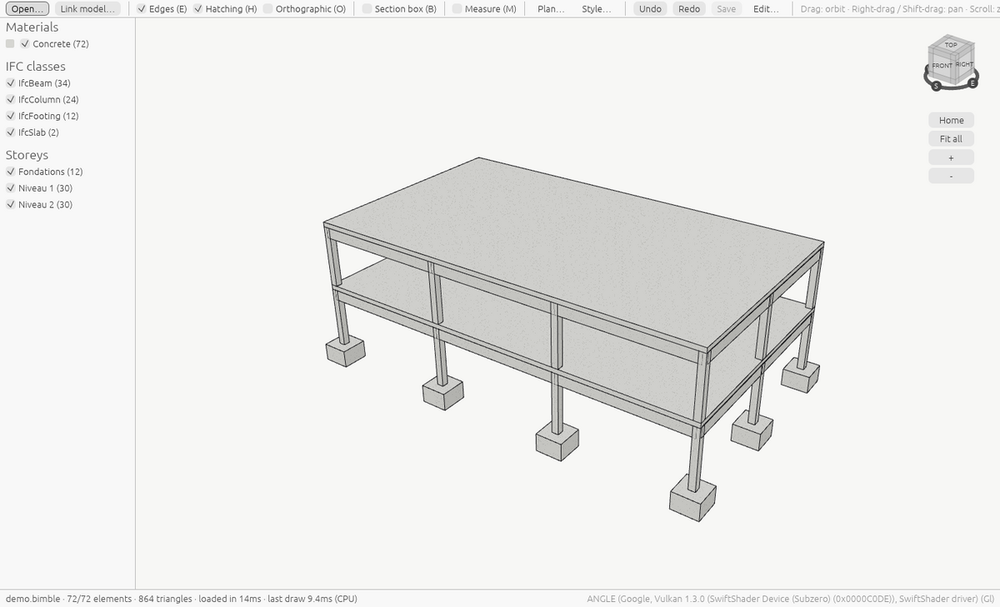

# Bimble

Bimble is an open-source structural BIM tool for engineering offices. It is fast on old machines,
uses IFC as its data model, and treats the drawing as the product.

With Bimble you can:

- **open IFC files** and look at them: 3D views, plans looking down or up and sections with a
  view range, another office's plan on top to check it against, filters by material, IFC class
  and storey, a section box, measuring, a view cube;
- **compare** your model with another one, such as the architect's IFC, and see what only one of
  them has;
- **draw storey plans at scale** (1:1 to 1:5000) on A4 to A0, as PDF, SVG or PNG. Plans can have
  grid axes, dimension chains, a legend and your office's title block;
- **convert any IFC** into an editable `.bimble` model, **edit** it (columns, beams, walls,
  slabs by their dimensions; every other element moved and versioned) with undo, and **version**
  it: commits, branches, merges and a shared folder to work together, like Git but element by
  element;
- **share a model for viewing** as a small `.bimbleview` file that opens in seconds, also in a
  browser;
- do all of it **in a browser**, with nothing to install. The files you open stay on your computer.

!!! warning "A preview"
    Bimble is young. It reads IFC for viewing and plans, and edits `.bimble` models converted
    from them. Report
    what doesn't work in the [issues](https://github.com/guilbep/bimble/issues).

## Where to start

- [Install](manual/install.md) Bimble, or open it [in your browser](manual/browser.md).
- [First steps](manual/first-steps.md): open a model and move around it.
- [Storey plans](manual/plans.md): from a model to a printed plan.
- [Command line](reference/cli.md): every command, for scripts and batch work.

## Links

- Source code: [github.com/guilbep/bimble](https://github.com/guilbep/bimble), MIT licence.
- Downloads: [releases](https://github.com/guilbep/bimble/releases).
- Design decisions: the [ADRs](https://github.com/guilbep/bimble/tree/main/docs/adr) in the source.
