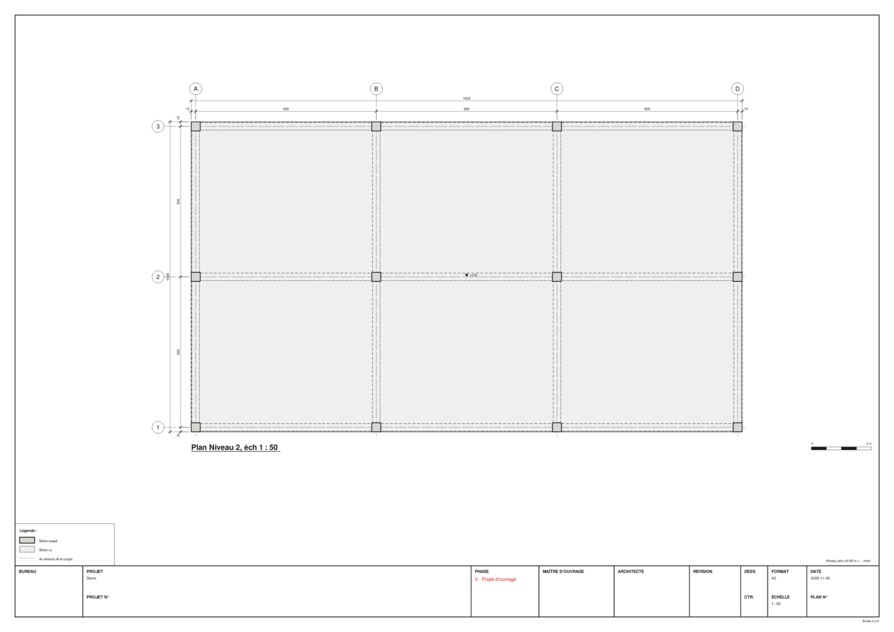

# Storey plans

Bimble draws a storey plan **at scale** (1:1 to 1:5000), on A4 to A0, as PDF, SVG or PNG. The plan
is an exact horizontal section of the model, not a screenshot: a 300 mm column is 3 mm on paper
at 1:100.



## What a plan shows

The plan cuts the model at a height above the storey level, 1.2 m by default, and looks down:

- **Cut**: what the plane cuts (walls, columns), filled and hatched by material, with a thick outline.
- **Seen**: what lies below the cut, down to the storey level (the slab, beams, footings), filled
  lighter, with thin edges. Higher elements hide lower ones.
- **Above**: edges of the storey's elements above the cut, up to the next storey, dashed. On a
  formwork plan, these are the beams under the slab above.

Around the drawing:

- **grid axes** with bubbles. They come from the model's IFC grid, or, when it has none, are drawn
  through the cut columns (A, B, C… one way, 1, 2, 3… the other);
- **dimension chains** on the top and left: first from the outer face through the axes, then the
  overall size. Dimensions are in cm by default;
- **slab levels** on the slabs seen below the cut, and a **cross** in their rectangular openings;
- a **legend**, the **title** ("Plan Level 1, 1:100"), a **level note**, a **graphic scale bar** and
  the **title block**.

Reinforcement, spaces, openings, annotations and terrain are left out.

All of this can be changed with a [plan template](#your-offices-plans-templates).

## In the viewer

Open a model, then **Plan…** in the toolbar:

| Setting | What it does |
|---|---|
| Storey | The storey to draw |
| Scale 1: | 1:N; type a number or pick 50, 100, 200, 500 |
| Paper | A4…A0, or **Smallest that fits** (landscape or portrait) |
| Cut height | Height of the cut plane above the storey level, mm |
| Seen fills, Axes, Dimensions, Legend, Levels | Switch those parts on or off |
| Template… | Load a plan template (JSON); **Default** goes back to the built-in one |

Tick **Preview** to see the sheet as it will print. Drag the slider to zoom in. The preview is
redrawn when a setting changes.

**Export PDF…** and **Export SVG…** save the sheet. In a browser they download it.

If the plan doesn't fit the paper at that scale, Bimble says so and suggests the scale that fits:

```text
at 1:50 the plan (19.2 × 11.2 m) needs 420 × 271 mm and does not fit on A3; 1:75 fits on A3
```

## From the command line

```sh
bimble info model.ifc                                  # lists the storeys and their levels
bimble plan model.ifc plan.pdf --storey "Level 1"      # 1:100, smallest paper that fits
bimble plan model.ifc plan.svg --storey "Level 1" --scale 50 --paper A1
bimble plan model.ifc plan.png --storey "Level 1" --dpi 200
bimble plan model.ifc plan.pdf --storey "Level 1" --cut 900   # cut 0.9 m above the level
```

The output's extension chooses the format. All the options are in the
[command-line reference](../reference/cli.md#plan).

## Your office's plans: templates

The title block, the words on the sheet and what is shown come from a **plan template**, a JSON
file. A template lists only what differs from the built-in English one.

```sh
bimble plan-template > my-office.json           # the full default, to start from
bimble plan-template my-office.json             # checks a template and prints it in full
bimble plan model.ifc plan.pdf --storey N01 --template my-office.json \
    --field phase="Projet d'ouvrage" --field drawing_no=S-101
```

A French template in the layout of a Swiss engineering office's formwork plans is included:
[`docs/templates/plan-fr.json`](https://github.com/guilbep/bimble/blob/main/docs/templates/plan-fr.json).
It has *Béton coupé* and *Béton vu* in the legend, *Plan N01, éch 1 : 100* as the title, and a title
block with project, phase (in red), client, architect, revision, drawn/checked, format/scale and
date/plan number.

Values such as the phase or the client go in the template's `fields`, or on the command line with
`--field key=value`. Every key is described in the [plan template reference](../reference/plan-template.md).

Colours, hatches and pen widths come from the [graphic style](styles.md), not the template.

## Limits

- Hidden lines are removed correctly for flat tops only. A sloped slab or a stair can show lines
  that should be hidden ([#22](https://github.com/guilbep/bimble/issues/22)).
- Openings aren't dimensioned yet. There are no element labels or section markers either
  ([#24](https://github.com/guilbep/bimble/issues/24)).
