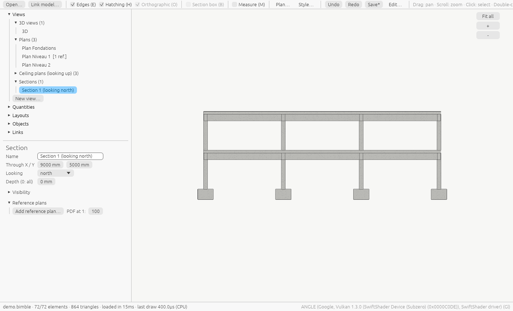
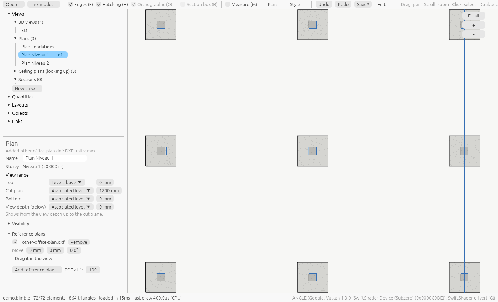

# Views and reference plans

A model has several **views**: 3D views, plans looking down, ceiling plans looking up, and
sections. Each view keeps its own camera, what it hides and its reference plans. You select,
edit and measure elements in a plan or a section exactly as in 3D.

## The model navigator

The top of the left panel lists everything in the model:

| Section | Holds |
|---|---|
| **Views** | 3D views, Plans, Ceiling plans (looking up), Sections. Click one to open it |
| **Schedules** | Tables of elements and quantities: click one to open it ([schedules](schedules.md)) |
| **Layouts** | The [sheets](sheets.md): click one to open it; **New sheet** |
| **Objects** | The elements by IFC class. Click one to select it and frame it |
| **Links** | The [linked models](linked-models.md), and every reference plan with its view |
| **Measurements** | The dimensions you took (see [Measuring](viewing.md#measuring)) |
| **Warnings** | Problems found while reading the file |

A view with reference plans shows how many, such as `Plan Niveau 1 [1 ref.]`.

### The views you start with

Every model has, without anything to set up:

- **3D**;
- **Plan** *storey* for each storey, looking down;
- **Ceiling** *storey* for each storey, looking up.

### New views

**New view…** under the list makes:

- a plan or a ceiling plan of any storey;
- a section looking north, east, south or west, through the middle of the model;
- another 3D view.

Right-click a view for **Duplicate**, or **Delete**. A view you started with can't be deleted, but
once you have changed it, **Reset to default** brings it back as it was.

## Plans and sections

In a plan or a section:

- the camera looks square to the view; **drag to pan**, scroll to zoom, double-click or ++f++ to
  fit;
- the view cube, Home, the section box and perspective are off: the view is cut by its range;
- clicking selects, the properties panel edits, ++m++ measures, as in 3D;
- placing elements (**Model** tab) in a plan puts them on that plan's storey.

**Ceiling plans** look up at the underside of the floor above, like a reflected ceiling plan:
north stays at the top and east on the right.

### Project north and true north

As in Revit, plans and sections are drawn in **project north**: along the building, whatever its
turn in the site. Bimble reads the turn from the IFC (the building's placement, or an IFC4 map
conversion). A section **looking north** looks along the building's north, on screen and on
paper. To draw a view with true north at the top, set its **Orientation** to **True north** in
the view's properties. A model whose building isn't turned is drawn the same either way.
`bimble info` prints the survey system and the turn.

### Coordinates

The status bar gives the coordinates of the point under the pointer (on an element, or on a
plan's cut), and of the point you snap to while measuring:

- in the model's **survey system**: for Swiss models **LV95**, the Swiss way,
  `E 2'600'123.45 N 1'200'456.78 · 432.10 m (LV95)`;
- or, in **Settings → Coordinates**, in **WGS84** latitude and longitude (GPS), worked out from
  LV95 to about a metre.

A model whose survey system isn't known shows metres in its own coordinates.

### View range

A plan shows what lies between two heights, set in its properties under **View range**:

| Plane | Looking down | Looking up |
|---|---|---|
| **Top** | Upper limit of the view's range | Upper limit of the view's range |
| **Cut plane** | Where the model is cut; you see down from here | Where the model is cut; you see up from here |
| **Bottom** | Lower limit | Lower limit |
| **View depth** | How far below the cut you see | How far above the cut you see |

Each plane is a **level** and an **offset** in mm:

- **Associated level**: the plan's storey;
- **Level above** or **Level below**: the next storey up or down;
- **Unlimited**: no limit (the offset is then ignored).

A plan looking down shows from the view depth up to the cut plane; a ceiling plan, from the cut
plane up to the view depth.

The planes must be in order, from the bottom up:

- looking down: view depth ≤ bottom ≤ cut plane ≤ top;
- looking up: bottom ≤ cut plane ≤ top ≤ view depth.

A range out of order is refused with a message, and the view keeps its previous range.

The usual cut is 1.2 m above the storey looking down and 2.3 m looking up. On a storey lower than
that, such as a foundation level, the cut starts at half the storey's height.

### Sections

A section's properties set:

- **Through X / Y**: the point the section passes through, in mm;
- **Looking**: north, east, south or west;
- **Depth**: how far beyond the cut you see, in mm; 0 shows everything.

## Visibility

Each view has its own **Visibility** list: material families, IFC classes and storeys. Untick one
to hide it in this view only. The plan of a storey can hide the footings while the 3D view shows
everything. Sheets and PDFs of the view leave out the same.

Each family opens (▸) into the **materials** found in the model, each with its own checkbox, and a
drop-down to draw that material as **another family** (its colour and hatches): useful when
*Other* holds most of the model. That choice is saved in the [graphic standards](styles.md), so it
applies to every model; the Standards panel lists the moved materials, each with × to undo it. A
click on a family's colour square opens its colour in the Standards panel.

## Reference plans

A reference plan is another office's drawing, such as the architect's floor plan, laid over a plan
or a section to check that the geometry matches and to measure on it.

- It is shown **only in its view**.
- It is **dead geometry**: its lines can't be selected or changed, only moved.
- It is drawn in the reference colour (blue by default).

### Add one

1. Open the plan or section.
2. **Collaborate → Link DXF** or **Link PDF**; or, in the view's properties under **Reference
   plans**, **Add reference plan…**; or drop the file on the window.
3. Pick the file:
    - **DXF**: read with its units (`$INSUNITS`; millimetres when the file doesn't say). Lines,
      arcs, circles, ellipses, polylines (with arcs), splines, solids, and blocks are read, from
      model space; text and hatches are not (the message counts what was left out).
    - **PDF**: the vector lines of the first page. Set its scale in **PDF at 1:** *before* adding it
      (1:100 by default). A scanned PDF has no lines to read.
    - **DWG**: not read directly. Convert it to DXF first, with the free
      ODA File Converter or LibreDWG's `dwg2dxf`.

A DXF drawn in the project's coordinates lands where it belongs. When the plan's coordinates are
far from the model (a PDF, a drawing at the origin), it is centred on the model and the message
says so: then move it into place.

### Move it into place

- Type the **Move** offsets (X and Y in mm, along the view) and the rotation in degrees, or
- turn on **Drag it in the view** and drag: the plan follows the mouse. Turn it off to pan again.

### Measure on it

With Measure (++m++) on, points snap to the reference plan's corners and lines as well as to the
model. Measure from a column of the model to the same column on the architect's plan to see how
far apart they are.

### Hide or remove it

The tick box next to its name shows or hides it; **Remove** takes it out of the view. A new version of the file: **Collaborate → Manage links → Reload** (or **Reload from…**),
and the lines change where the plan was placed.

## On paper

Any plan, ceiling plan or section can be printed at scale: **Sheets → On paper…** draws the view
you are looking at. See [Plans and sections on paper](plans.md), and [Sheets](sheets.md) to put
several views on one page.

## Where views are saved

- In a **`.bimble` model**, views are part of the model: saved with it, undone with ++ctrl+z++, and
  kept in its [history](history.md).
- An **IFC file** is never changed. Its views go in a file next to it, named after it:
  `model.ifc.bimble-views.json`. **Save**, or ++ctrl+s++, writes it; it is read the next time you
  open the IFC. In a browser, it is downloaded instead; open or drop it after the IFC to get the
  views back.

Reference plans are stored inside the view (as lines in mm), so the model or the side file carries
them: the original DXF or PDF is no longer needed.
