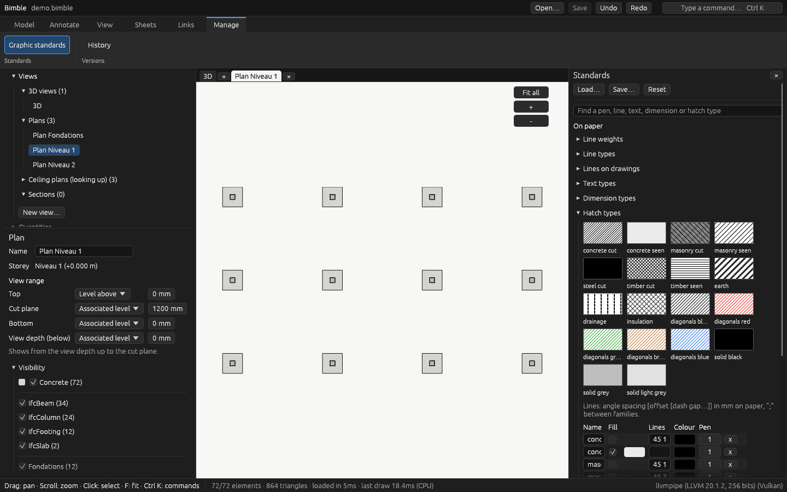

# The window

From top to bottom:

- **Top row**: **Bimble**, the [**File** menu](#the-file-menu), the ribbon's tabs; at the right
  the file's name and what isn't saved (cut short when the row is full, whole on hover), then
  **Open**, **Save**, **Undo**, **Redo** as icons and the [command palette](#the-command-palette)
  button.
- **Ribbon**: tabs of tools, in named groups. A tool that is on looks pressed; one that can't be
  used now is grey. Its tooltip gives its name and key.
- **Left**: the project browser (views, layouts, objects, links), and under it the properties of
  what is selected, else of the view. While you place an element, they show its storey and sizes.
- **Tabs** of the views and sheets you opened, over the drawing. Click one to go back to it; **×**
  or a middle click closes it.
- **Right**: the [Standards](styles.md) panel, when open.
- **Status bar**: what a click does now (place a column, measure, add a text…), the state chips
  (below), then the counts: elements shown, triangles, load time, the model's memory, and the
  pictures drawn per second (*idle* when nothing moves).

While a file opens, a card over the 3D view shows the file, the step (reading, geometry,
preparing the view…), how far it is, the time spent and a progress bar.

## The File menu

| Group | Entries |
|---|---|
| Files | **Open…**, **Import IFC…**, **Convert to .bimble (editable)…** ([editing](editing.md#editing-an-ifc-file)), **Save** |
| Share | **Share for viewing… (.bimbleview)** ([viewing](viewing.md#share-for-viewing)) |
| Links | **Link a model…** ([linked models](linked-models.md)), **Reference plan (DXF, PDF)…** ([views](views.md)) |
| Paper | **On paper…** ([plans](plans.md)) |
| Project | **Project information** ([project](project.md)), **Settings…** ([below](#settings)) |
| | **History…** and **Exit**, on the desktop |

## The ribbon

| Tab | Groups and tools |
|---|---|
| **Project** | *Project*: Project information ([project](project.md)). *Links*: Model… ([linked models](linked-models.md)), Reference plan… ([views](views.md)) |
| **Model** | *Place*: Column, Beam, Wall, Slab ([editing](editing.md)). *Inspect*: Measure |
| **Annotate** | *On the sheet*: Select, Text, Dimension, and the text and dimension types they use ([sheets](sheets.md)). *On plans*: Section labels, Openings, Section marks, Levels ([plans](plans.md#what-a-plan-shows)) |
| **View** | *Show*: Edges, Hatching, Orthographic. *Cut*: Section box, Box to selection. *Camera*: Fit all, Top |
| **Sheets** | New sheet, Close sheet; *Export*: On paper… ([plans](plans.md)) |
| **Manage** | Graphic standards ([styles](styles.md)), Materials ([materials](materials.md)), History ([history](history.md), desktop) |

## Nothing implicit

What Bimble is doing that isn't its default is always written on screen, with a way back:

- **State chips**, in the status bar: *Placing: column*, *Measuring*, *Sheet tool: dimension*,
  *Section box*, *Edges off*, *Hatching off*, *Orthographic*, *Hidden: 2 classes, 1 storey*,
  *3 measurements*, *Plan options changed*. Click a chip's **×** to go back to the default; its
  tooltip says what that does (for *Hidden*, everything is shown again and saved with the view).
- **Not saved**: the top row says what isn't saved, in words: *Not saved: model, standards*.
- **Undo** and **Redo** say what they would do ("Undo: move P1"), and are greyed when there is
  nothing to undo. **Save** says what it saves.
- **Closing** with something not saved asks: **Save and close**, **Close without saving**, or
  **Cancel**. In a browser, leaving the page asks too.
- **Reset to default…** in the standards asks first; **Revert** goes back to the style file as
  loaded or saved.

## The command palette

++ctrl+k++, or the button at the top right, opens the **command palette**. Type part of a command
("sec box", "dim", "col") and press ++enter++, or click it. Each command shows its ribbon tab and
its key. ++up++ and ++down++ move, ++esc++ or a click outside closes it. Every tool of the
ribbon is there, and so is every view ("Go to Plan Level 1"), sheet and schedule.

## Settings

**File → Settings…** holds what belongs to this computer, not to a model. It is saved in
Bimble's `settings.json` (in a browser, the browser's storage) and applies to every model.

- **Appearance**: the **theme** (Grey by default, Dark, Light, Solarized dark and light, High
  contrast; every text readable on every surface), the **font** (Roboto or Ubuntu Light) and the
  **text size** (10–16 pt, 12 by default). Changes apply at once.
- **Memory for one model**: the share of this computer's memory a model may use (80 % by
  default). A model that needs more asks [which part to show](viewing.md#models-too-large-for-the-machine).
  The window says how much the open model holds; **Reopen with this limit** applies a new value.
  In a browser the limit is what a tab can address, 4 GB.
- **While the view moves**: the pictures per second to keep while you orbit, pan or zoom
  (15 to 240 fps, 30 by default), or **Draw everything**. Below that rate Bimble leaves out
  what is smallest on screen while the view moves; a still view is always whole.
  **Simplified far parts while moving** also draws distant parts as simplified shapes on a
  machine below that rate. **Test shared shapes' copies on the GPU** is experimental.
